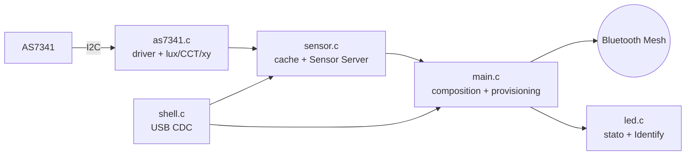

<div align="center">

# 🌈 Spettrometro Mesh

**Nodo Bluetooth Mesh per luce e colore.**
Seeed XIAO nRF52840 + AMS AS7341 (11 canali spettrali), esposto come Sensor Server SIG.


[Funzionalità](#-funzionalità) · [Hardware](#-hardware) · [Quick start](#-quick-start) · [Stato LED](#-stato-led) · [Shell](#-shell-usb) · [Troubleshooting](#-troubleshooting)

</div>

---

## ✨ Funzionalità

| | |
|---|---|
| 💡 **Illuminamento** | Lux (SIG `0x0055`), con calibrazione da app |
| 🌡️ **Temperatura di colore** | CCT in kelvin (SIG `0x0051`), metodo McCamy |
| 🎨 **Cromaticità** | Coordinate CIE 1931 x/y (SIG standard) |
| 📊 **Spettro** | F1–F8 (415–680 nm), clear e NIR in un tipo custom `0xF341` |
| ⚙️ **Autogain** | Guadagno regolato sul canale clear, da 0,5× a 256× |
| 🌉 **Remote Provisioning** | Il nodo fa da ponte per provisionare altri nodi via mesh |
| 🔁 **Relay + GATT Proxy** | Estende la rete e permette la configurazione da smartphone |
| 🖥️ **Shell USB** | `node status`, `node reset`, `node dfu`, `node scan` via CDC |

Campionamento ogni 5 s, pubblicazione mesh ogni 30 s. I quattro sensori stanno sullo stesso elemento: un solo *Sensor Descriptor Get* li scopre tutti.

## 🔌 Hardware

| Componente | Dettaglio |
|---|---|
| MCU | Seeed XIAO nRF52840 Sense (`xiao_ble`) |
| Sensore | AMS AS7341, I²C `0x39` |
| Alimentazione | 3,3 V dal XIAO |

Il sensore può stare su due coppie di pin; il firmware prova entrambe all'avvio:

| Bus | SDA | SCL |
|---|---|---|
| `i2c1` (default scheda) | D4 | D5 |
| `i2c0` (rimappato nell'overlay) | D9 (P1.14) | D10 (P1.15) |

```text
 XIAO nRF52840            AS7341
 ┌───────────┐          ┌────────┐
 │ 3V3       ├──────────┤ VIN    │
 │ GND       ├──────────┤ GND    │
 │ D4 / D9   ├── SDA ───┤ SDA    │
 │ D5 / D10  ├── SCL ───┤ SCL    │
 └───────────┘          └────────┘
```

> Servono i pull-up su SDA/SCL (presenti sulla maggior parte delle breakout AS7341).
> Il pinmux di D9/D10 è in [`boards/xiao_ble.overlay`](boards/xiao_ble.overlay).

## 🏗️ Architettura



| File | Responsabilità |
|---|---|
| [`src/main.c`](src/main.c) | Composition mesh, provisioning, reset, avvio |
| [`src/as7341.c`](src/as7341.c) | Driver registri (SMUX, guadagno, tempo di integrazione), calcolo lux/CCT/xy |
| [`src/sensor.c`](src/sensor.c) | Cache protetta da mutex, 4 sensori mesh, calibrazione lux, campionamento |
| [`src/led.c`](src/led.c) | LED RGB di stato e *Attention* (Health Server) |
| [`src/shell.c`](src/shell.c) | Comandi `node ...` su USB CDC |
| [`prj.conf`](prj.conf) | Configurazione Zephyr / Bluetooth Mesh |

Modelli esposti: Configuration Server, Health Server, Sensor Server, Remote Provisioning Server.
Company ID `0x0059`, nome in advertising `AS7341 Light`.

Approfondimenti: [README-mesh.md](README-mesh.md) (modelli e sensori) · [CALIBRAZIONE-LUX.md](CALIBRAZIONE-LUX.md) (taratura del lux da app).

> Il fattore conteggi → lux (`LUX_K`, in `as7341.c`) è indicativo: va tarato con un luxmetro.

## 🚀 Quick start

**Prerequisiti:** nRF Connect SDK v3.3.1 con toolchain installata (Windows + Git Bash).

```bash
# build (percorsi di default: C:/ncs, toolchain 936afb6332)
./build.sh

# toolchain o versione diverse
NCS_TOOLCHAIN=/c/ncs/toolchains/<hash> NCS_VERSION=v3.3.1 ./build.sh
```

Variabili supportate: `NCS_ROOT`, `NCS_VERSION`, `NCS_TOOLCHAIN`, `BOARD`.
Output in `build/zephyr/` (`zephyr.uf2`, `zephyr.hex`).

**Flash**

1. Doppio click sul reset del XIAO: compare il drive `XIAO-SENSE`.
2. Copia `build/zephyr/zephyr.uf2` sul drive: il nodo si riavvia da solo.
3. Apri la porta seriale USB (115200): ogni 5 s compare una riga con lux, kelvin, clear e guadagno.

**Provisioning:** con il LED blu lampeggiante il nodo è provisionabile (PB-ADV / PB-GATT) da app o provisioner mesh.

## 💡 Stato LED

| Stato | LED |
|---|---|
| Provisionabile | 🔵 lampeggio breve ogni 1 s |
| Link di provisioning aperto | 🔵 fisso |
| Provisionato | 🟢 impulso ogni 3 s |
| Reset in corso | 🔴 lampeggio veloce per 2 s, poi torna provisionabile |
| Identify (Health Server) | ⚪ 4 lampi + pausa |

## 🖥️ Shell USB

| Comando | Funzione |
|---|---|
| `node status` | Stato, indirizzo mesh, lux/CCT, canali F1–F8, clear e NIR |
| `node reset` | Cancella provisioning e chiavi mesh |
| `node dfu` | Riavvia nel bootloader per aggiornare il firmware |
| `node scan` | Scansione I²C su entrambi i bus (diagnosi cablaggio) |

## 🛠️ Troubleshooting

| Sintomo | Causa probabile | Cosa fare |
|---|---|---|
| `AS7341 non trovato` nel log | Cablaggio o alimentazione | `node scan`: deve comparire `0x39`; ricontrolla SDA/SCL e VIN |
| `nessuna misura valida` | Sensore assente o prima lettura non ancora fatta | Attendi 5 s; il firmware riprova da solo ogni 5 s |
| Lux troppo alti/bassi | `LUX_K` non tarato | Calibra da app: [CALIBRAZIONE-LUX.md](CALIBRAZIONE-LUX.md) |
| Il nodo non compare nel provisioner | Già provisionato | `node reset` da shell |
| `build.sh`: toolchain non trovata | Hash/percorso diversi | Imposta `NCS_TOOLCHAIN` |
| Il drive `XIAO-SENSE` non appare | Doppio click troppo lento | Ripeti più rapidamente il doppio click su reset |
